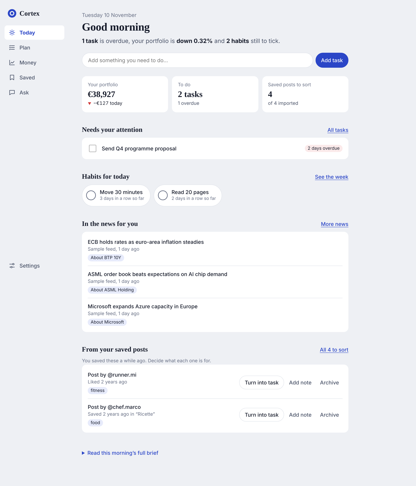

# Cortex

A personal command centre: one page for your day, your investments, the news that touches them, and the things you saved to act on later, with an agent that remembers you sitting on top.

This repository contains three things that are designed together:

1. **The product** (`app/`): a small self-hosted dashboard and agent.
2. **The operating model** (`.claude/`, `memory/`, `CLAUDE.md`): the team of AI agents that builds the product, organised on Google's Elephant-Goldfish model.
3. **The plan** (`docs/`): the research behind the choices, the architecture, the automations, and the roadmap.



## Run it

Requires Node.js 22.18 or later. Nothing else: no database server, no build step.

```bash
cd app
npm install
npm start          # http://127.0.0.1:4317
```

It starts in **demo mode** with synthetic prices and sample headlines, makes no outbound calls, and needs no keys. To use it for real:

```bash
cp config/cortex.example.json config/cortex.json   # set owner, feeds, mode "live"
export ANTHROPIC_API_KEY=...                        # optional: switches the agent on
npm start
```

| Command | What it does |
|---|---|
| `npm start` | Runs the dashboard, API, MCP endpoint and scheduler |
| `npm test` | Runs the test suite (16 tests, no network) |
| `npm run typecheck` | Type-checks the code |
| `npm run cli -- run morning-brief` | Fires one automation from the shell or from cron |
| `npm run cli -- import-instagram <path>` | Imports saved and liked posts from an Instagram data export |

## What works today, and what does not

| Area | Status |
|---|---|
| Tasks, habits, journal | Working and tested |
| Portfolio tracking, multi-currency valuation, allocation, 30-day trend | Working and tested on synthetic data |
| News ingest (RSS and Atom) with tagging against holdings | Working and tested on fixtures |
| Instagram saved and liked import, triage, convert to task | Working and tested on fixtures modelled on the export format; **not yet run on a real export** |
| Morning brief and weekly review, scheduled, with a figure check | Working and tested |
| MCP endpoint for external agents | Working and tested at protocol level; **not yet connected to a real client** |
| Agent chat with tools and long-term memory | Written and type-checked against the Anthropic SDK; **not yet run against the live API** (no key in the build environment) |
| Live price and feed providers | Written, parsers tested; **live endpoints unverified** (the build environment has no outbound access to them) |
| Delivery to ntfy, Telegram, webhook | Written; **untested** |

The first hour on your own machine should be spent closing those gaps. `docs/06-roadmap.md` lists them as milestone M1.

## Where to read next

| Document | Question it answers |
|---|---|
| [docs/01-landscape.md](docs/01-landscape.md) | Which open-source projects exist, and what did we take from each? |
| [docs/02-architecture.md](docs/02-architecture.md) | How is the product put together, and why this way? |
| [docs/03-agent-operating-model.md](docs/03-agent-operating-model.md) | Who are the agents, what does each remember, and how do they review each other? |
| [docs/04-automations.md](docs/04-automations.md) | What runs without being asked, and when? |
| [docs/05-external-agents.md](docs/05-external-agents.md) | How do other agents and services connect, in and out? |
| [docs/06-roadmap.md](docs/06-roadmap.md) | What is built, what is next, and what are the exit criteria? |
| [docs/design-system.md](docs/design-system.md) | What are the visual rules? |

## Boundaries

Cortex tracks investments. It does not place trades, and nothing it says is regulated financial advice. Personal data stays in `app/data/`, which is excluded from git.

`alessandro_de_luca.html` predates this project and is untouched.
